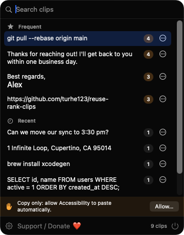
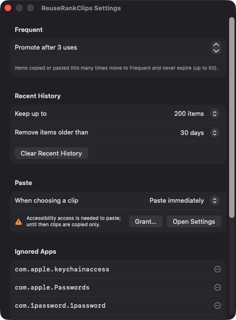
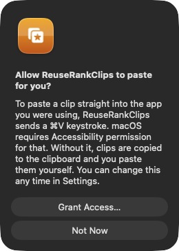

# ReuseRankClips

**🌐 Website:** [turhe123.github.io/reuse-rank-clips](https://turhe123.github.io/reuse-rank-clips/)

A clipboard history that learns which items you paste again and again and promotes them to a favorites list.

> 🆓 A free, open-source **PromptClip alternative** for macOS 14+. Native Swift, no accounts, no subscriptions, MIT licensed.


## Why

ReuseRankClips is a free, open-source, 100% native, backend-free alternative to paid utilities in the *Clipboard* category. It was inspired by PromptClip ($9.99 one-time), which showed how useful it is to keep repeated text close at hand. Everything runs on your Mac: no accounts, no servers, no network access.

## Features

- **Menu bar popup** (SwiftUI `MenuBarExtra`, about 360 × 460 pt), opened by clicking the menu bar icon or with a global hotkey (default ⌘⇧V, configurable).
- **Automatic promotion**: the app polls the pasteboard twice a second and counts how often each distinct text is copied or pasted back. At a configurable threshold (default 3 uses, range 2–20), an item moves into the **Frequent** list.
- **Frequent above Recent**: Frequent items never expire (capped at 50; if the cap is exceeded, the least recently used non-pinned item drops back to Recent). Each row shows a use-count badge.
- **Rename, Pin, Demote, Delete** from a right-click menu or the row's "…" button. Labels can be up to 60 characters.
- **Search** filters both sections by text and label. Arrow keys move the highlight, Return pastes, Escape closes.
- **Paste into the previous app**, or copy only, your choice in Settings.
- **Deduplication**: items are keyed by a normalized hash of the trimmed text, so repeated copies increment one record instead of creating duplicates.
- **Privacy-minded capture**: skips items marked concealed/transient/auto-generated (for example by password managers), items from ignored apps (editable bundle-ID list), and items over 1 MB.
- **History controls**: keep 50–1000 recent items and remove items older than 1 day, 1 week, 30 days, 90 days, or never. Frequent and pinned items are never expired. A "Clear Recent History" button is provided.
- **Local-only storage**: JSON in `~/Library/Application Support/ReuseRankClips/clips.json`, written with debounced saves on a background queue. A corrupted store is backed up and replaced with an empty one.
- **Launch at login** via `SMAppService`.
- Long text is stored in full; previews are truncated to three lines.

Only plain text is captured; images and files are not.

## Screenshots

<p align="center"></p>

<p align="center"><em>The menu bar popup with frequently reused clips promoted above recent history, each showing its use count.</em></p>

<p align="center"></p>

<p align="center"><em>Settings for the promotion threshold, history limits, paste behavior, and ignored apps.</em></p>

<p align="center"></p>

<p align="center"><em>On first launch, the app explains why it needs Accessibility access before asking for it.</em></p>

## Install

1. Download `ReuseRankClips-macOS.zip` from the [latest release](https://github.com/turhe123/reuse-rank-clips/releases/latest).
2. Unzip it and move `ReuseRankClips.app` to `/Applications`.
3. Because the app is open source and not notarized, clear the quarantine flag:

   ```bash
   xattr -cr /Applications/ReuseRankClips.app
   ```

4. Right-click the app and choose **Open** the first time you launch it.

## Build from source

Requires macOS 14+ and Xcode with Swift 5.9+.

```bash
brew install xcodegen
xcodegen generate
xcodebuild -project ReuseRankClips.xcodeproj -scheme ReuseRankClips -configuration Release -derivedDataPath ./build build
```

The app is produced at `build/Build/Products/Release/ReuseRankClips.app`.

## Permissions

- **Accessibility** (optional): needed only to paste directly into the app you were using. The app sends a synthetic ⌘V keystroke, which macOS gates behind Accessibility. It explains this on first launch before the system prompt appears. Without it, ReuseRankClips still works but copies the clip to the clipboard and you paste it yourself.

The app does **not** request Screen Recording, Microphone, Camera, Contacts, or any other permission, and makes no network connections (the Support button just opens your browser). The global hotkey uses the Carbon hotkey API, which needs no permission.

## Support ❤️

If ReuseRankClips saves you time, you can support development:

[Support Or (Leo) Davidai ❤️](https://ko-fi.com/leodavidai)

There is also a "Support / Donate ❤️" button inside the app.

## More free Mac apps

ReuseRankClips is one of [60 free, open-source Mac utilities](https://github.com/turhe123/mac-apps) built the same way: native Swift, no accounts, no telemetry. Browse the full gallery at [turhe123.github.io/mac-apps](https://turhe123.github.io/mac-apps/).

## License

MIT © Or Davidai Bachar
